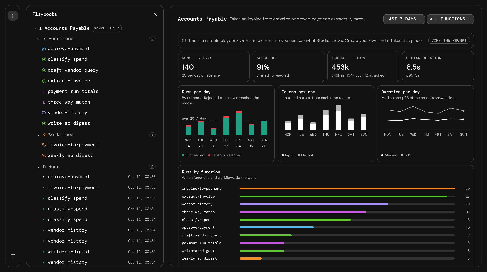

# Auto Runtime

**Describe how you want the work done.** Auto builds a working playbook you can test, change and run again. You decide when it runs and what it is allowed to do.

A playbook contains one **brain**, its reusable function collection, and **workflows** that coordinate those functions. Functions can also run directly. Each function or workflow call produces a **run** with its result and the versions used. Connections provide authorized access to external services.

Your agent builds and directs the work. **Auto Runtime** stores and executes it; [**Auto Studio**](https://studio.on.auto) lets you inspect and manage it.

## Get started

Start Auto Runtime on your computer with `npx @on.auto/runtime`. It needs Node.js 26.10 or later on macOS or Linux, and listens on `http://localhost:5555` in local mode, where every request on your computer acts as you, with no sign-in; `PUBLIC_URL=http://localhost:5555` signs you in through the Auto identity service instead. Every release is also the image `onauto/runtime` on Docker Hub; see [Run with Docker](docs/self-host/docker.md) and the [self-hosting guides](docs/self-host.md).

Follow the [local setup guide](docs/get-started/local.md) or browse the [Auto documentation](https://on.auto/docs/). See [function availability](docs/concepts/functions.md#availability) for implemented capabilities.

_Local runtime with synthetic Accounts Payable data._

## Contribute and get help

See [CONTRIBUTING.md](CONTRIBUTING.md) for development setup and checks, and [documentation contributions](docs/contributing/documentation.md) to preview a guide. [Open an issue](https://github.com/BeOnAuto/runtime/issues/new/choose) for bugs and questions; report vulnerabilities through [SECURITY.md](SECURITY.md).

## License

Auto Runtime is source-available under the [Elastic License 2.0](LICENSE). [LICENSING.md](LICENSING.md) explains the terms. Contributions follow the [CLA](CLA.md) and [Code of Conduct](CODE_OF_CONDUCT.md).
