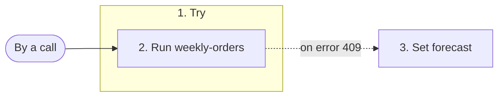

# next-week-orders

Forecasts a region's orders for next week, or answers none while no version is active.

## What starts it

- By a call of `run_definition`, from a caller or from a step of another workflow

## What it needs

| Field | Required | What it is |
| --- | --- | --- |
| **region** | yes | Text. |
| **promotion** | yes | A number. |

## What it produces

It produces any output, which its document does not describe.

## What it does

Its steps, numbered as in the diagram:

1. **forecast** tries step 2; on an error with status 409, when `$error.kind == "no_active_version"`, it does step 3.
2. **ask** runs the prediction function **weekly-orders**.
3. **none** sets **forecast**.

## What it calls

Its steps call:

- the prediction function **weekly-orders**
