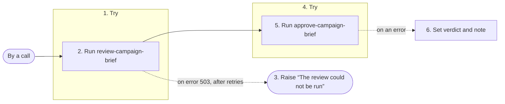

# review-and-approve

Reviews a campaign brief, then asks its owner to approve the review.

## What starts it

- By a call of `run_definition`, from a caller or from a step of another workflow

## What it needs

| Field | Required | What it is |
| --- | --- | --- |
| **brief** | yes | Text. |
| **owner** | yes | Text. |

## What it produces

It produces any output, which its document does not describe.

## What it does

Its steps, numbered as in the diagram:

1. **review** tries step 2; on an error with status 503, it tries again under the retry policy **patient**, and once no retry is left, it does step 3.
2. **review-brief** runs the reasoning function **review-campaign-brief**.
3. **give-up** raises the error *The review could not be run*, with status 503.
4. **approval** tries step 5; on an error whose type is `https://on.auto/problems/unanswered`, it does step 6.
5. **ask-for-approval** runs the interaction function **approve-campaign-brief**.
6. **no-answer** sets **verdict** and **note**.

## What it calls

Its steps call:

- the reasoning function **review-campaign-brief**
- the interaction function **approve-campaign-brief**
