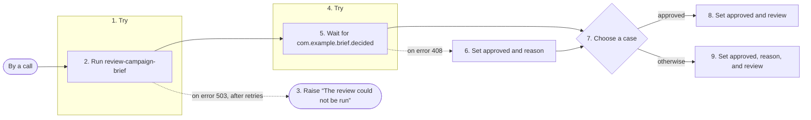

# review-and-approve

Reviews a campaign brief, then waits up to a week for an approval decision.

## What starts it

- By a call of `run_definition`, from a caller or from a step of another workflow

## What it needs

| Field | Required | What it is |
| --- | --- | --- |
| **brief** | yes | Text. |

## What it produces

It produces any output, which its document does not describe.

## What it does

Its steps, numbered as in the diagram:

1. **review** tries step 2; on an error with status 503, it tries again under the retry policy **patient**, and once no retry is left, it does step 3.
2. **review-brief** runs the reasoning function **review-campaign-brief**.
3. **give-up** raises the error *The review could not be run*, with status 503.
4. **decision** tries step 5; on an error with status 408, it does step 6.
5. **wait-for-decision** waits for the event **com.example.brief.decided**, for at most 7 days.
6. **no-answer** sets **approved** and **reason**.
7. **route** chooses the first case that holds: **approved**, when `$data.decision.approved === true`, goes to step 8 and **otherwise**, by default, goes to step 9.
8. **approve** sets **approved** and **review**, and then ends the run.
9. **decline** sets **approved**, **reason**, and **review**.

## What it calls

Its steps call:

- the reasoning function **review-campaign-brief**
