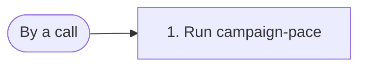

# campaign-pace-table

Computes the pace of each campaign and answers it as a table.

## What starts it

- By a call of `run_definition`, from a caller or from a step of another workflow

## What it needs

| Field | Required | What it is |
| --- | --- | --- |
| **rows** | yes | A list. |
| **period** | yes | A record. |

## What it produces

It answers a table of 1 to 50 **columns**, each a **name** of its own with a **unit** where given, and at most 500 **rows**, each one cell for each column: text, a number, yes or no, or nothing.

## What it does

Its steps, numbered as in the diagram:

1. **pace** runs the computation function **campaign-pace**.

## What it calls

Its steps call:

- the computation function **campaign-pace**
