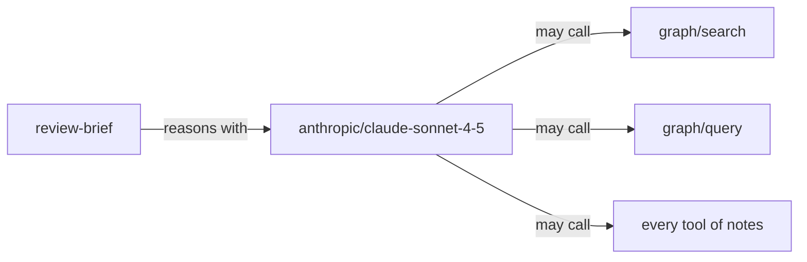

# review-brief

Reviews a campaign brief against the team's criteria

## What it needs

| Field | Required | What it is |
| --- | --- | --- |
| **brief** | yes | Text. |
| **criteria** | yes | Text. |

## What it produces

Text: the answer the model writes.

## Which model and tools

It reasons with the model `anthropic/claude-sonnet-4-5`.

It may call these tools:

- the tool **search** of **graph**
- the tool **query** of **graph**
- every tool of **notes**

The model may call these tools before it answers, several in one step and over several steps, within a run's limits on calls, time and failures.

## What it is told

Its instructions, which it follows on every run:

Review the brief using the supplied criteria. Identify missing evidence. Do not invent facts.

Its message, with the values of each run in place of the names in bold:

Brief: **brief**
Criteria: **criteria**
