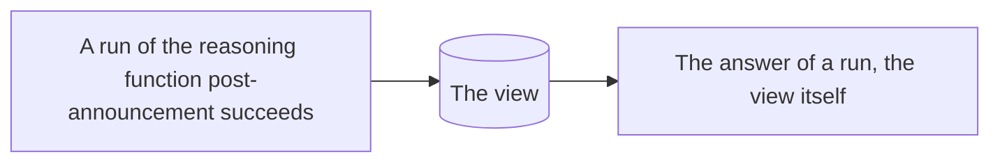

# announcements

What the post-announcement function returned, oldest first, the last 50

## What it remembers

It remembers, from the first event of the playbook's history on:

- each time a run of the reasoning function **post-announcement** succeeds

## What it keeps

It keeps one view, which its program updates with each event it remembers:

A list of at most 50 items.

## What it answers

Each run takes:

Any input, which its document does not describe.

It answers with the view itself, as it stands.

## How it is kept

Its view is built from the first event of the playbook's history when the function is saved, and again whenever it changes, and is kept up to date as the events it remembers arrive.

The program, its `fold`, is TypeScript and is shown under Source.
