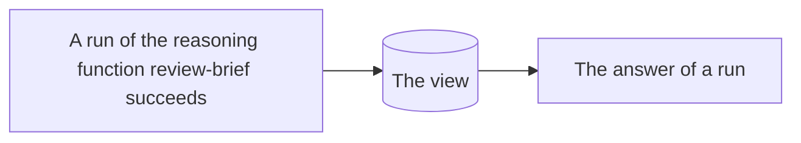

# campaign-reviews

The reviews of each campaign, latest last, as the review-brief function wrote them

## What it remembers

It remembers, from the first event of the playbook's history on:

- each time a run of the reasoning function **review-brief** succeeds

## What it keeps

It keeps one view, which its program updates with each event it remembers:

A record of at most 50 entries, each a list of at most 20 records with: **at** (text), **verdict** (text), **run** (text).

## What it answers

Each run takes:

| Field | Required | What it is |
| --- | --- | --- |
| **campaign** | yes | Text. |
| **last** | no | A whole number, from 1 to 50. |

It answers with what its program makes of the view and that input:

A list of records with: **at** (text), **verdict** (text), **run** (text, optional).

## How it is kept

Its view is built from the first event of the playbook's history when the function is saved, and again whenever it changes, and is kept up to date as the events it remembers arrive.

The program, its `fold` and its `answer`, is TypeScript and is shown under Source.
